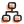

<h1 align="center">Antheo Design Skills</h1>

<p align="center">
  <picture>
    <source media="(prefers-color-scheme: dark)" srcset="assets/strip-dark.svg">
    
  </picture>
</p>

<p align="center">
  Twenty design skills for coding agents. Exact values, firm rules and small checking tools,<br>
  so the interfaces your agent builds look finished and work for everyone.
</p>

<p align="center">
  <a href="#install">Install</a> · <a href="#the-skills">Skills</a> · <a href="#how-a-skill-works">How a skill works</a> · <a href="#done-means-checked">Done means checked</a> · <a href="#evals">Evals</a> · <a href="#license">License</a>
</p>

## Install

```sh
npx skills add antheo-design/skills
```

The [skills installer](https://skills.sh) finds the agents on your machine and puts the skills where each one looks:
`.claude/skills` for Claude Code, and `.agents/skills` for Codex, Cursor, OpenCode and the others that share it.

```sh
npx skills add antheo-design/skills -g                # every project, not just this one
npx skills add antheo-design/skills -a claude-code    # one agent
npx skills add antheo-design/skills -s antheo-build   # one skill
npx skills add antheo-design/skills -l                # list them first
```

Or copy `skills/antheo-*` into your agent's skills folder by hand. Each skill is a plain folder with a `SKILL.md`, so
it works in any agent that reads [Agent Skills](https://agentskills.io).

The tools need Node 18 or later. The browser checks also need Playwright in your project (`npm i -D playwright-core`)
and Chrome, or `npx playwright install chromium`.

## Start

Ask the way you would ask a teammate. Your agent picks the skill.

```
Build a settings page for our app: profile, notifications and billing.
```

```
Our dark mode looks muddy. Fix it.
```

```
Is this page ready to ship? http://localhost:3000/pricing
```

Every build starts with **antheo-build**. It pastes one designed style block, follows its rules, and opens another
skill only when the work needs it: a table brings in antheo-data, a dialog that opens brings in antheo-motion, "ready
to ship?" brings in antheo-review.

## The skills

### Start here

| Skill | What it does |
|---|---|
| <picture><source media="(prefers-color-scheme: dark)" srcset="assets/icons/dark/antheo-build.svg"></picture>&nbsp; [antheo&#8209;build](skills/antheo-build/SKILL.md) | Starts every UI request: one designed style block to paste first, and the rules that keep a screen compact and quiet |

### Set the look

| Skill | What it does |
|---|---|
| <picture><source media="(prefers-color-scheme: dark)" srcset="assets/icons/dark/antheo-direction.svg"></picture>&nbsp; [antheo&#8209;direction](skills/antheo-direction/SKILL.md) | Gives a landing or brand page its own identity, only when you ask for something expressive |
| <picture><source media="(prefers-color-scheme: dark)" srcset="assets/icons/dark/antheo-tokens.svg"></picture>&nbsp; [antheo&#8209;tokens](skills/antheo-tokens/SKILL.md) | Puts your brand on the style block with every text pair measured, or writes a full token set for a design system |
| <picture><source media="(prefers-color-scheme: dark)" srcset="assets/icons/dark/antheo-color.svg"></picture>&nbsp; [antheo&#8209;color](skills/antheo-color/SKILL.md) | Picks the colour roles and passes WCAG 2.2 contrast in every theme and state |
| <picture><source media="(prefers-color-scheme: dark)" srcset="assets/icons/dark/antheo-type.svg"></picture>&nbsp; [antheo&#8209;type](skills/antheo-type/SKILL.md) | A small type scale, two weights, numbers that line up, and fallback fonts drawn at the same size |
| <picture><source media="(prefers-color-scheme: dark)" srcset="assets/icons/dark/antheo-layout.svg"></picture>&nbsp; [antheo&#8209;layout](skills/antheo-layout/SKILL.md) | One column, one left edge, and a grid that holds from 320 to 2560px, in long languages and right to left |
| <picture><source media="(prefers-color-scheme: dark)" srcset="assets/icons/dark/antheo-surface.svg"></picture>&nbsp; [antheo&#8209;surface](skills/antheo-surface/SKILL.md) | Depth without outlines: a faint edge, a soft drop, three corner sizes, in light and dark |

### Build the pieces

| Skill | What it does |
|---|---|
| <picture><source media="(prefers-color-scheme: dark)" srcset="assets/icons/dark/antheo-components.svg"></picture>&nbsp; [antheo&#8209;components](skills/antheo-components/SKILL.md) | Single controls with exact sizes and every state |
| <picture><source media="(prefers-color-scheme: dark)" srcset="assets/icons/dark/antheo-data.svg"></picture>&nbsp; [antheo&#8209;data](skills/antheo-data/SKILL.md) | Tables, charts and figures people can compare |
| <picture><source media="(prefers-color-scheme: dark)" srcset="assets/icons/dark/antheo-writing.svg"></picture>&nbsp; [antheo&#8209;writing](skills/antheo-writing/SKILL.md) | Every word in the interface: plain, specific and ready to translate |
| <picture><source media="(prefers-color-scheme: dark)" srcset="assets/icons/dark/antheo-motion.svg"></picture>&nbsp; [antheo&#8209;motion](skills/antheo-motion/SKILL.md) | Decides whether a thing should move, then gives its timing, easing and distance |
| <picture><source media="(prefers-color-scheme: dark)" srcset="assets/icons/dark/antheo-moment.svg"></picture>&nbsp; [antheo&#8209;moment](skills/antheo-moment/SKILL.md) | The one signature moment, kept for a rare and meaningful event |
| <picture><source media="(prefers-color-scheme: dark)" srcset="assets/icons/dark/antheo-access.svg"></picture>&nbsp; [antheo&#8209;access](skills/antheo-access/SKILL.md) | Keyboard, screen reader, voice, touch and zoom, to WCAG 2.2 AA |
| <picture><source media="(prefers-color-scheme: dark)" srcset="assets/icons/dark/antheo-mobile.svg"></picture>&nbsp; [antheo&#8209;mobile](skills/antheo-mobile/SKILL.md) | Makes a web screen feel native on a phone: safe areas, the keyboard, bottom sheets |

### Check and keep

| Skill | What it does |
|---|---|
| <picture><source media="(prefers-color-scheme: dark)" srcset="assets/icons/dark/antheo-stress.svg"></picture>&nbsp; [antheo&#8209;stress](skills/antheo-stress/SKILL.md) | Breaks the screen on purpose: long text, nothing at all, ten times the data, right to left |
| <picture><source media="(prefers-color-scheme: dark)" srcset="assets/icons/dark/antheo-review.svg"></picture>&nbsp; [antheo&#8209;review](skills/antheo-review/SKILL.md) | Answers "ready to ship?" first, then gives measured findings, each with its file and line |
| <picture><source media="(prefers-color-scheme: dark)" srcset="assets/icons/dark/antheo-motion-audit.svg"></picture>&nbsp; [antheo&#8209;motion&#8209;audit](skills/antheo-motion-audit/SKILL.md) | Audits the motion across a whole app and removes what should not move |
| <picture><source media="(prefers-color-scheme: dark)" srcset="assets/icons/dark/antheo-system.svg"></picture>&nbsp; [antheo&#8209;system](skills/antheo-system/SKILL.md) | Works with an app that already exists: extracts its values, maps them to tokens, migrates, learns your taste |

### Ask about it

| Skill | What it does |
|---|---|
| <picture><source media="(prefers-color-scheme: dark)" srcset="assets/icons/dark/antheo-critique.svg"></picture>&nbsp; [antheo&#8209;critique](skills/antheo-critique/SKILL.md) | A second pair of eyes: names the plain problems, raises matters of taste as questions, redesigns nothing unasked |
| <picture><source media="(prefers-color-scheme: dark)" srcset="assets/icons/dark/antheo-explain.svg"></picture>&nbsp; [antheo&#8209;explain](skills/antheo-explain/SKILL.md) | Explains how an interface was built, layer by layer, and says how sure it is of each claim |

## How a skill works

Every skill is a folder with up to three parts:

```
skills/antheo-motion/
  SKILL.md       the rules your agent reads the moment the skill starts
  references/    deeper files it opens only when the work calls for one
  scripts/       tools it runs to check its own work
```

**SKILL.md** is short on purpose: the decisions, the values and a checklist for done. Your agent reads it whole.

**references/** holds the detail a task sometimes needs: the style block itself, the recipe for one kind of
animation, the pattern for a pricing page, the habits to catch before calling work done. The agent opens one file
when the job needs it and never loads the rest, so twenty skills cost almost nothing until they are used.

**scripts/** are plain Node files with no dependencies. They measure what an agent would otherwise guess: contrast,
layout at seven widths, the words on a screen, every hardcoded value in a codebase.

<details>
<summary>The tools</summary>

| Tool | Skill | What it does |
|---|---|---|
| `check-page.mjs` | review | Opens a page at seven widths in light and dark and reports what is broken, with a score |
| `gate.mjs` | review | Keeps the agent working until the page check and the copy check pass |
| `a11y-probe.mjs` | access | Walks a page by keyboard: focus order, traps, dialogs, zoom, forced colours |
| `copy-lint.mjs` | writing | Finds weak words, vague buttons and broken plurals in JSX, Vue, Svelte, Angular and server templates |
| `contrast.mjs` | color | WCAG 2.2 contrast and APCA for any two colours |
| `block.mjs`, `tokens.mjs` | tokens | The style block in your brand, or a full token set, with every pair measured |
| `variant-bar.js` | build | Three versions on the real page, switched with the keys 1, 2 and 3 |
| `scan-motion.mjs` | motion audit | Every animation in a codebase, with drift in durations and curves |
| `audit-values.mjs` | system | Every hardcoded value in a codebase, grouped and mapped to tokens |
| `inspect.mjs` | explain | One element's layers, styles and animations |

</details>

## Done means checked

An agent saying "done" proves nothing. These skills ask for proof.

- **The gate.** Before the agent may finish, `gate.mjs` runs the page check and the copy check on every page the work
  touched. It allows three rounds, and a finding can only be waived with a written reason.
- **Two reviewers, kept apart.** antheo-review runs one reviewer on the screenshots and one on the measurements, in
  separate contexts, then merges what they found and lists where they disagree.
- **Evidence or nothing.** A finding names its file and line, or its screenshot. A number that was not measured never
  decides a verdict, and anything that could not be checked is listed as not verified.
- **Reproduce first.** A fix starts by showing the problem on the running page and ends by showing it gone. A change
  that did not help is undone before the next idea.

<details>
<summary>Make the gate automatic</summary>

In Claude Code, add a stop hook to `.claude/settings.json`:

```json
{
  "hooks": {
    "Stop": [{ "hooks": [{ "type": "command", "command": "node .claude/skills/antheo-review/scripts/gate.mjs hook" }] }]
  }
}
```

Codex, Cursor and OpenCode have no stop hook, so add one line to `AGENTS.md`:

> Before saying a UI change is done, run `node .agents/skills/antheo-review/scripts/gate.mjs check` and fix what it
> lists.

For skills installed with `-g`, use the folders the installer printed; they sit in your home directory.

</details>

## Any stack

The skills judge what people see, so the framework does not matter. Load the style block once, globally, before any
other CSS; templates use its classes, and components, Tailwind and theme objects read its names. The page checks take
a URL, so they run against any dev server.
[`stacks.md`](skills/antheo-build/references/stacks.md) shows where the block goes in React, Vue, Svelte, Angular,
Astro, Django, Flask, Rails, Laravel and Phoenix.

## Evals

[`evals/`](evals) holds twenty briefs, one per skill. Every check is measured in a real browser or read from the
written answer, never judged by eye. Run each brief twice, once without the skill and once with it, and grade both:

```sh
node evals/run.mjs out/with --baseline out/without --html report.html
```

A skill earns its place when its side passes more checks and fails none that the plain side passes.
[`evals/README.md`](evals/README.md) has the prompts for Codex, Claude Code and other agents.

## Principles

1. **Clean is counts.** Few text sizes, two weights, three corner sizes, almost no lines, almost no colour.
2. **One set of names.** Every colour, size, corner, shadow and duration has one name, defined once.
3. **Only what was asked.** No invented features, data or copy.
4. **Measured, not guessed.** Real pages, real widths, both themes.
5. **Proven by a run.** A claim about a screen comes with the check that shows it.

## Pairs well with

These skills own how an interface looks, reads, moves and works for people, not how its code is structured. For that,
pair them with Vercel's react-best-practices for React performance and Matt Pocock's tdd and diagnosing-bugs skills.

## License

Free to use in your own work and your clients' work, commercial work included, and free to change. You may not sell
the skills themselves, or a product or service whose value comes mainly from them. MIT with the Commons Clause; the
full text is in [LICENSE](LICENSE).

## Contributing

Issues and pull requests are welcome. A change to a skill should come with an eval brief, or a change to one, that
shows the difference.
